<div align="center">

# 营造 Yingzao

**现代装修企业的营造法式**

*The Open-Source ERP for the Renovation Industry*

[](#license)
[]()
[]()
[]()
[]()
[]()
[]()
[]()
[]()

**客源 · 报价 · 合同 · 施工 · 材料 · 结算 —— 装修行业全链条,一个系统管完**

[快速开始](#快速开始) · [架构](#架构三层皆插件) · [业务全景](#业务全景行业插件套件) · [界面预览](#界面预览) · [双端形态](#双端形态内部员工端--外部客户端) · [路线图](#路线图) · [文档](#文档)

</div>

---

## 这是什么

**营造(Yingzao)** 是一套面向装修行业(家装/整装/局装)的开源 ERP:从**客源线索**进来,到**报价、合同、施工、材料、结算**出去,行业全价值链一个项目覆盖。

它不是"通用 ERP 加几个装修字段",而是把装修行业二十年被验证过的业务模型——报价定额库、施工节点排期、主材销售、选材结算——以干净的架构重新建造一遍。

### 为什么叫"营造"

名字取自宋代李诫的**《营造法式》**——中国第一部建筑设计与施工标准。它发明的**材分模数制**:构件按标准模数在作坊预制、到现场拼装,宫殿与民居用同一套模数体系——这正是一千年前的**插件化架构**。

本项目以同样的思想构建:

> **核心只做平台与插件框架,一切业务皆插件,一切公司特性皆插件。**
> 装哪套插件,它就是谁家的系统。

### 它解决什么问题

- 装修行业数字化碎片化:获客一个 SaaS、报价一个工具、施工一个 App、财务一套金蝶,数据割裂,对不上账;
- 现有装修软件多为黑盒闭源,装企被供应商绑定,想改一个审批流都要等排期;
- 通用开源 ERP(Odoo/ERPNext 等)缺少装修行业深度:没有施工节点、定额报价、选材结算这些行业心脏。

营造的答案:**行业深度开源**——核心开源 + 行业插件套件开源,装企可自部署、可二开、可贡献回社区。

## 架构:三层皆插件

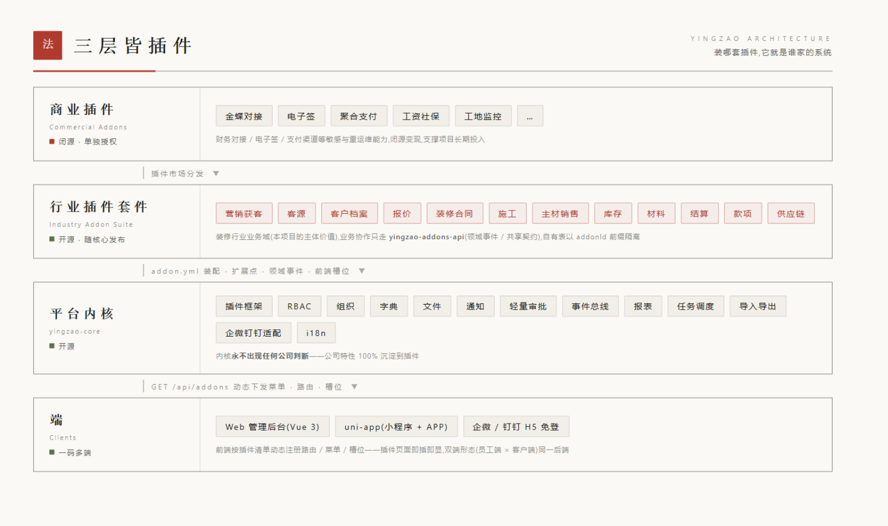

<details>
<summary>文字版架构图(无图环境 / 可搜索)</summary>

```text
┌─ 商业插件(闭源)────────────────────────────────────┐
│   金蝶对接 / 电子签 / 聚合支付 / 工资社保 / 工地监控 / …   │
├─ 行业插件套件(开源,随核心发布)────────────────────────┤
│   营销获客 / 客源 / 客户档案 / 楼盘 / 报价 / 合同 /       │
│   施工 / 主材销售 / 库存 / 材料 / 结算 / 款项 / 供应链 /    │
│   会员营销                                              │
├─ 平台内核 yingzao-core(开源)──────────────────────────┤
│   插件框架 + RBAC / 组织 / 字典 / 文件 / 通知 / 审批 /     │
│   报表 / 任务调度 / 导入导出 / 企微钉钉适配 / i18n         │
└─ 端 ────────────────────────────────────────────────┘
    Web 后台(Vue3) · uni-app(小程序 + APP) · 企微 / 钉钉 H5 免登
```

</details>

| 层 | 开源 | 职责 |
|---|:---:|---|
| 平台内核 `yingzao-core` | ✅ | 插件框架(扩展点/领域事件/前端槽位)、组织账号、RBAC、字典、文件、通知、审计、i18n 等通用设施。**内核永不出现任何公司判断** |
| 行业插件套件 `addons/*` | ✅ | 装修行业业务域,随核心一起发布,是本项目的主体价值 |
| 商业插件 | ❌ | 财务对接、电子签、支付渠道等敏感/重运维能力,闭源变现,支撑项目长期投入 |

插件之间**禁止互相依赖实现**,只通过 `yingzao-addons-api`(领域事件与共享契约)协作;插件自有表以 `{addonId}_` 前缀隔离,核心表结构永不因插件变更。

## 界面预览

视觉方向:**东方纸墨极简**(纸白暖底 / 墨黑 / 朱印红唯一点缀 / 宋体 display / 方角 / 8px 材分模数),Web 与移动端同源同构。

**Web 管理后台**(Vue3 + Element Plus,插件菜单动态注册)

<p>
  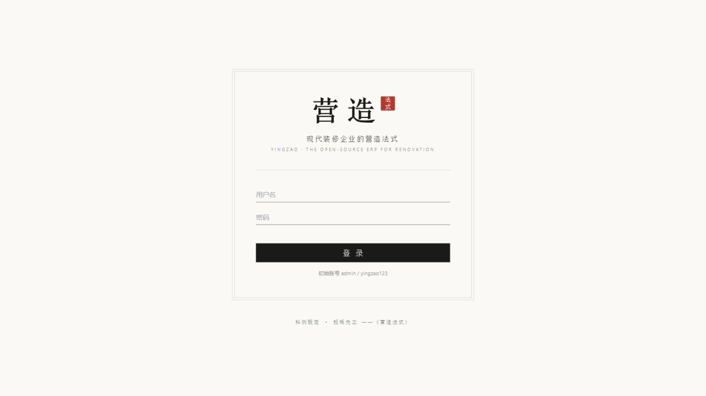
  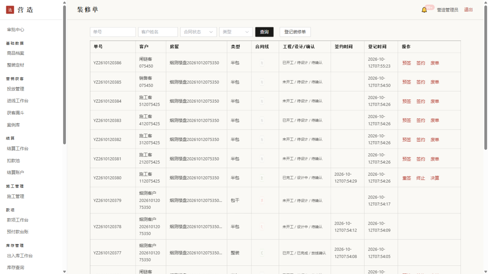
</p>
<p>
  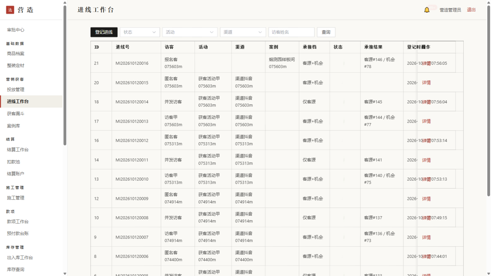
  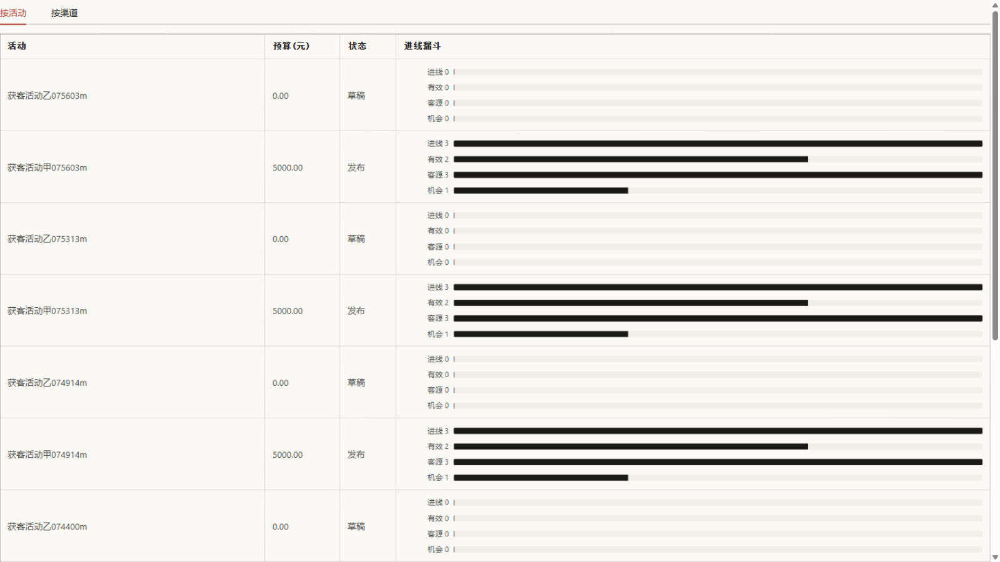
</p>
<p>
  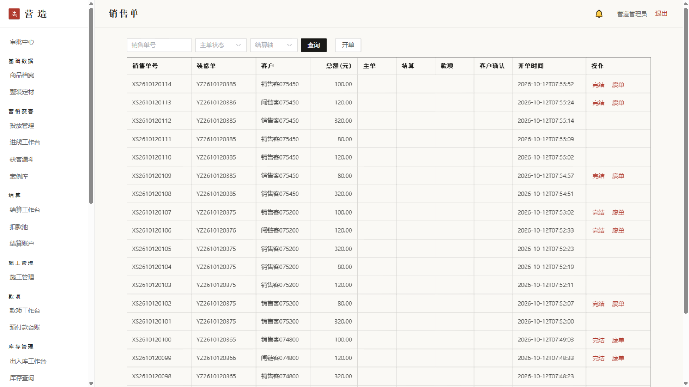
  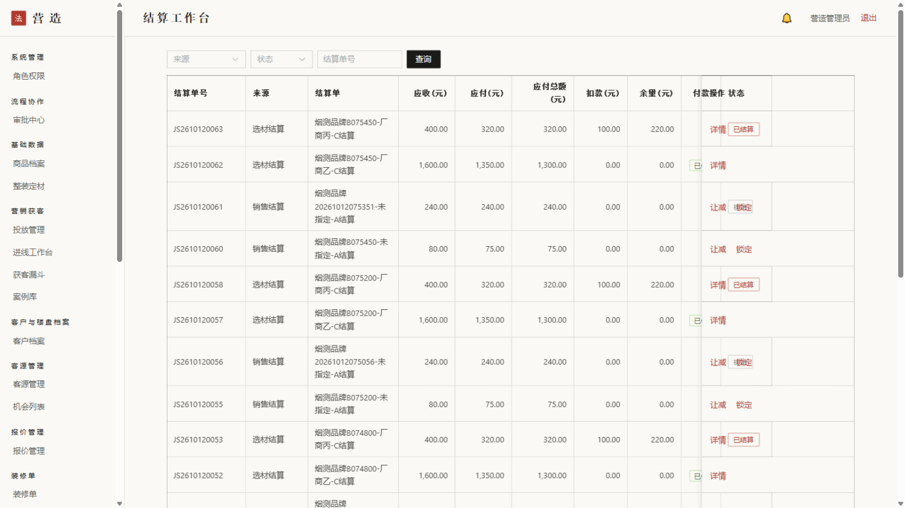
</p>
<p>
  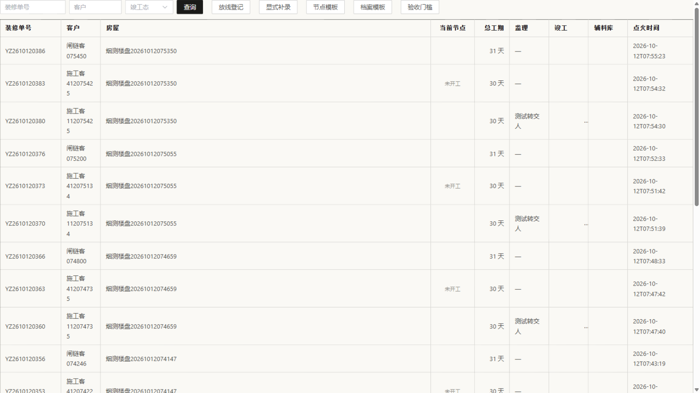
  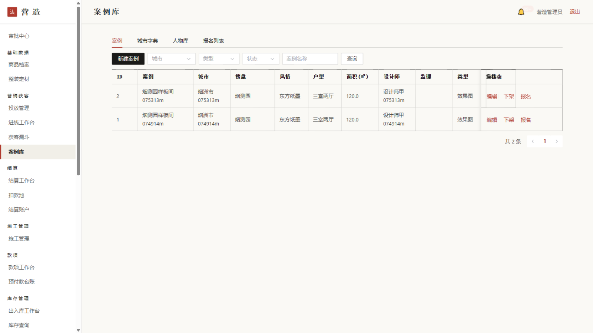
</p>
<p>
  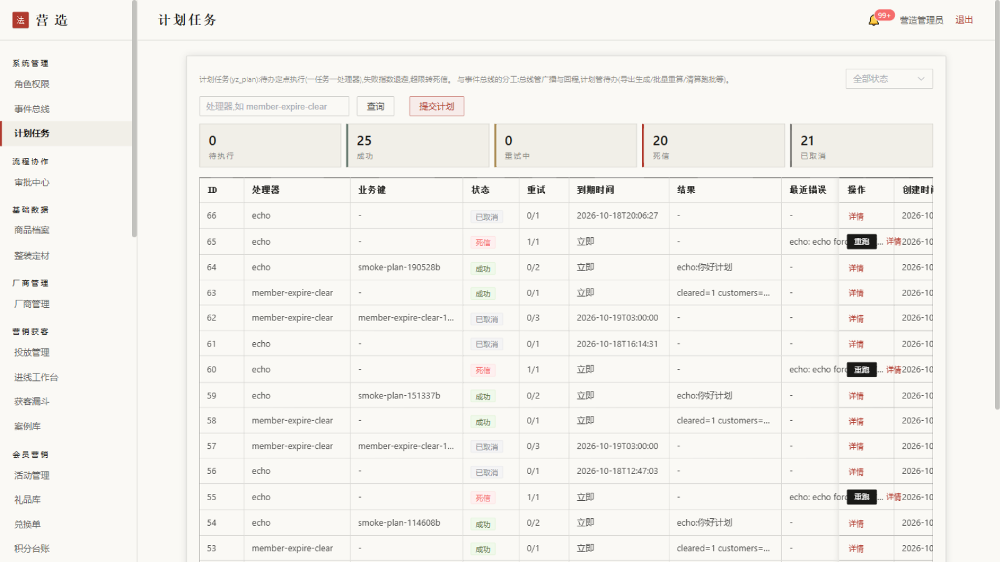
</p>

**员工端**(uni-app 一码三出:小程序 + APP + H5)

<p>
  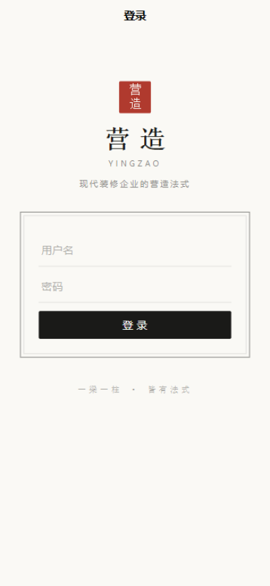
  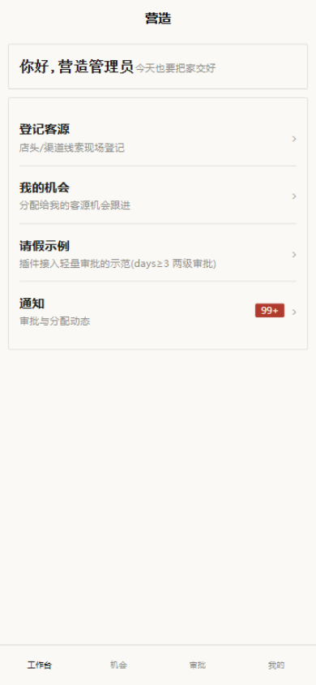
  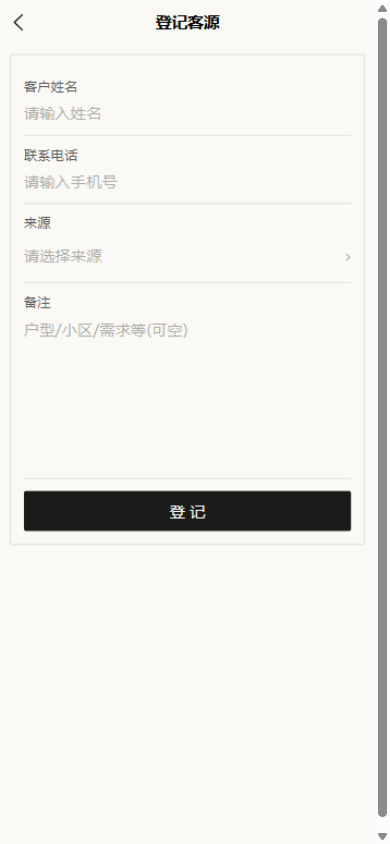
</p>
<p>
  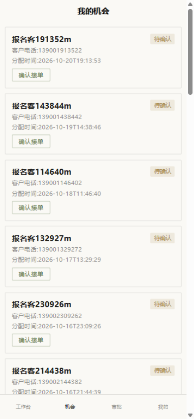
  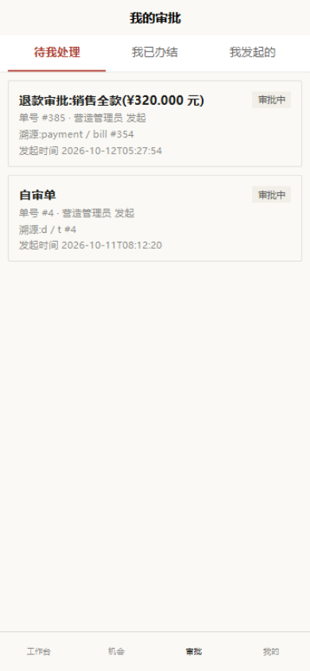
  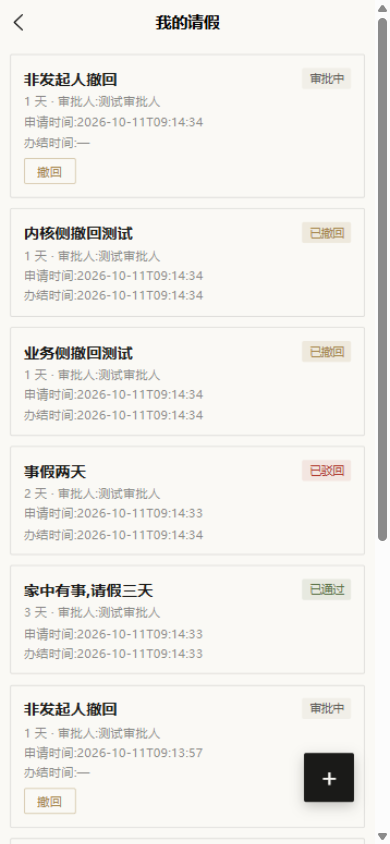
</p>
<p>
  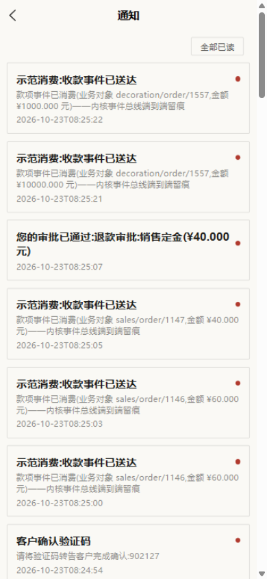
  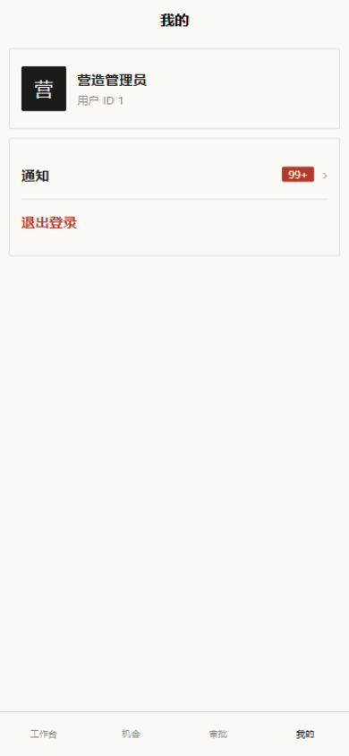
</p>

**客户端门户**(web-mp,H5 已上线:案例匿名浏览 / 进度 / 积分 / 验证码登录)

<p>
  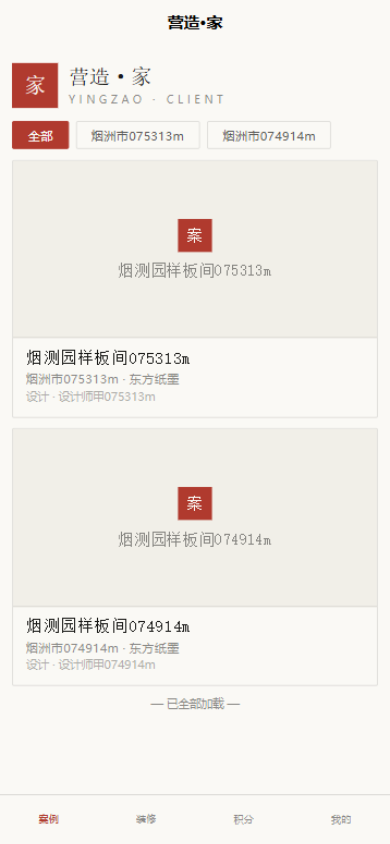
  
  
</p>
<p>
  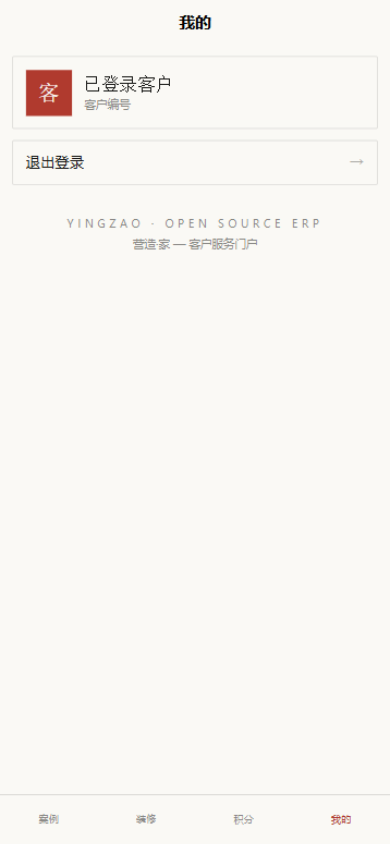
  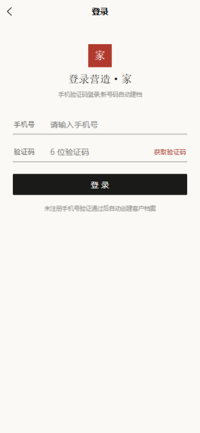
</p>

> 更多截图见 [docs/screenshots/](docs/screenshots)(客源/款项/审批中心/机会/请假等)。

## 双端形态(内部员工端 × 外部客户端)

装修行业天然是两个世界:**内部员工**(客源/报价/施工/结算)与**外部客户**(业主看进度/案例/保修/积分)。营造采用**同一后端、双前端应用**的形态:

- **员工端**(本仓库 `app/`,uni-app 一码三出):工作台/客源登记/机会跟进/审批/通知,走账号密码登录 + RBAC 权限;功能路线图(P0 工作台配置化宫格/审批动态表单/施工域页面族 → P1 客源补全/销售款项/辅料 → P2)见 [员工端 PRD](docs/prd/app-employee.md);
- **客户端**(本仓库 `web-mp/`,独立 uni-app 工程,H5 已上线):案例匿名浏览、施工进度脱敏视图、会员积分、手机验证码登录(未注册手机号验证通过后自动建客户档案);V2 规划(P0 资金流水/工地相册 → P1 客户确认中心/分享海报 → P2 报修/会员码)见 [客户端门户 PRD](docs/prd/webmp-portal.md);小程序与 APP 待微信 appid / 短信凭证后发布;
- 两侧共用同一套 `yingzao-addons-api` 契约与内核设施(通知中心/审批/加密盒),客户端匿名开放端点由 RBAC v2 匿名段统一鉴权——后端无需为"双端"做任何分叉。

## 业务全景(行业插件套件)

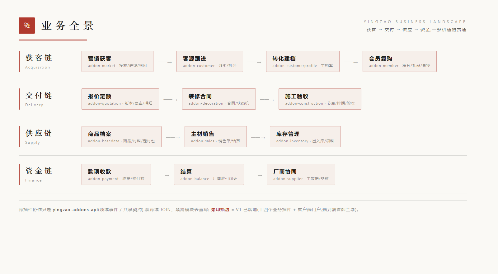

<details>
<summary>文字版业务全景(无图环境 / 可搜索)</summary>

```text
获客链:  渠道/进线/归因(addon-market) ─→ 线索/跟进(addon-customer) ─→ 转化建档(addon-customerprofile) ─→ 会员复购(addon-member)
交付链:  报价定额(addon-quotation) ─→ 装修合同(addon-decoration) ─→ 施工节点/排期/验收(addon-construction)
供应链:  商品/材料档案(addon-basedata) ─→ 主材销售(addon-sales) ─→ 库存/材料(addon-inventory / addon-material)
资金链:  款项/收款(addon-payment) ─→ 结算(addon-balance) ─→ 厂商协同(addon-supplier)
```

</details>

| 插件 | 业务域 | 状态 |
|---|---|---|
| `addon-market` | 营销获客:活动×渠道→投放源(渠道码/二维码/UTM)、进线(幂等+手机密文+动态表单)、承接事件化、三级归因漏斗、官网案例库 | ✅ V1.0 |
| `addon-customer` | 客源:线索登记、分配(手动/自动轮询)、机会状态机、撞单策略三档可配置、营销进线承接 | ✅ V1.3 |
| `addon-customerprofile` | 客户档案:城市/楼盘/房屋、客户主档(手机加密+读取留痕)、收款账户 | ✅ V1.0 |
| `addon-basedata` | 基础数据:品类/品牌/商品/SKU/价格体系/套餐/型号/定材包、Excel 导入器(商品/价格体系/型号) | ✅ V1.3 |
| `addon-quotation` | 报价:版本费率、功能区分组明细、服务端金额聚合、锁定/审核双线、定材包挂包、增减差量线(含净退款)、报价项库+保价重算 | ✅ V1.5 |
| `addon-decoration` | 装修单:登记七联动、四线状态机、签约拆款、量房/确认/终止审批、决算六项前置检查(组织级可配)、三口径表(半包配比/整装满减/包干增项) | ✅ V1.3 |
| `addon-construction` | 施工:放线点火、节点排期、比例闸、团队留痕、验收竣工、辅料额度契约 | ✅ V1.3 |
| `addon-material` | 材料域:1.x 代主材子订单(生产新增早已停),拆分归并裁决——主链不迁、结算并入 addon-sales/payment(见 rules/material.md) | 🚧 V2 规划 |
| `addon-sales` | 主材销售:四轴状态机、服务端算价、配送四级、结算三段式、退货审批链、定金/尾款双轴+退定金 | ✅ V1.2 |
| `addon-inventory` | 库存:单据即库存、12 类货单(含套合/套拆)、领料定材校验+额度双闸、领料审批线(审核中/通过出库/驳回回退)、外辅/采购厂商引用化 | ✅ V1.6 |
| `addon-balance` | 结算:结算汇聚(事件快照吸附)、账户双腿、扣款池、完结唯一定义、毛利管理线(两线两主体×17 周期版本化发布) | ✅ V1.1 |
| `addon-payment` | 款项:款项单、统一收据双人留痕、批量收款 N:1(一笔到账收 N 单)、预付款科目台账、退款走审批(整单/部分) | ✅ V1.3 |
| `addon-supplier` | 厂商协同:厂商主数据(查重下沉 DB)、品牌关联、三层结算条款、ext_no 幂等同步 | ✅ V1.0 |
| `addon-member` | 会员营销:活动/礼品库存/积分账户(事件驱动记账)/兑换单、发货登记、过期清算、签约自动核销、礼品采购流(父单链分批入库) | ✅ V1.3 |
| `addon-portal` | C 端门户:手机验证码登录、案例库匿名浏览、施工进度脱敏视图、会员积分查询 | ✅ V1.0 |
| `addon-target` | 经营目标:目标挂组织树任一节点(公司/分区/部门)、签约额/渠道进线双业绩线、阶段目标(月内切阶段)、调整留痕、子树实绩聚合 | ✅ V1.2 |
| `addon-service` | 售后服务:投诉(三态+超期徽章+回访联动)/回访任务(三来源+草稿闭环+满意度)/保修登记(保修期=起点+月数查询期计算) | ✅ V1.0 |

> 完整的模块判定过程(老系统 41 模块逐一过堂)见 [docs/01-剔除保留清单.md](docs/01-剔除保留清单.md);各插件的实现口径(状态机/金额/字典)见 [docs/rules/](docs/rules),业务闭环见 [docs/prd/](docs/prd)。

## 核心特性

- **插件化架构(自研)**——编译期装配的插件框架:`addon.yml` 清单、扩展点钩子、领域事件、前端槽位注册表、数据扩展约定。公司差异零侵入核心;
- **事件总线(outbox 三件套 + exactly-once)**——同事务落箱、失败指数退避重试、死信可见可重放、消费登记消除常态重放;跨插件协作 = 领域事件 + addons-api 契约(如营销进线→客源承接→回写),无跨域 JOIN、无跨模块表直写;
- **行业全链条**——获客 → 建档 → 报价 → 合同 → 施工 → 材料 → 结算,一条价值链贯通,十五个业务插件 + 客户端门户 + 示范插件 V1 已落地,回归冒烟 2100+ 步持续全绿;
- **一码多端**——Web 管理后台(Vue3 + Element Plus)+ 员工端 uni-app(小程序/APP/H5)+ 客户端门户 uni-app(H5 已上线)+ 企微/钉钉免登,一套账号体系收口;前端按 `GET /api/addons` 下发的插件清单动态注册路由/菜单/槽位,插件页面即插即显;
- **干净的数据模型**——无历史包袱:业务状态机显式化(迁移表白名单)、金额统一最小单位(厘)、查重下沉 DB 唯一约束、PII 字段加密(AES-256-GCM)+ 读取留痕、错误码按插件分段、i18n 中英双语从第一行代码开始;
- **组织与账号开箱即用**——组织树(公司→分区→部门,任意深度,子树数据范围)、用户管理(建号/停用踢会话/重置密码)、角色权限(菜单/功能点/端点三级)、计划任务管理页,管理后台自成体系;
- **可审计的演进**——Flyway 全程管理 schema(内核与各插件独立版本分段),文档金字塔(需求规格书 / RFC / PRD / 规则清单)先于代码。

## 技术栈

| 端 | 选型 |
|---|---|
| 后端 | Java 17 · Spring Boot 3.3.x · Maven 多模块 |
| 数据 | MySQL 8 · Flyway(禁手工 SQL) · Redis(认证/会话) |
| 前端 Web | Vue 3 · Element Plus |
| 移动端 | uni-app(小程序 + APP 一码双出) · 企微/钉钉 H5 免登 |
| 部署 | Docker · docker-compose |

## 仓库结构

```text
yingzao/
├── yingzao-core            # 平台内核:插件框架 + 事件总线 + RBAC + 通知 + 轻量审批 + 加密盒
├── yingzao-addons-api      # 插件间契约:领域事件 / 共享扩展点(插件协作唯一通道)
├── addons/
│   ├── addon-market        # 营销获客(投放/进线/归因/案例库)
│   ├── addon-customer      # 客源(线索/机会/分配/营销承接)
│   ├── addon-customerprofile  # 客户档案(城市/楼盘/房屋/客户/账户)
│   ├── addon-basedata      # 基础数据(品类/品牌/商品/套餐/型号/定材包)
│   ├── addon-quotation     # 报价(版本费率/功能区分组明细)
│   ├── addon-decoration    # 装修单(四线状态机/签约拆款)
│   ├── addon-construction  # 施工(放线/节点排期/验收)
│   ├── addon-sales         # 主材销售(四轴状态机/结算三段式/退货)
│   ├── addon-inventory     # 库存(单据即库存/领料/外辅/采购)
│   ├── addon-payment       # 款项(款项单/收据/预付款科目)
│   ├── addon-balance       # 结算(结算汇聚/账户双腿/扣款池)
│   ├── addon-supplier      # 厂商协同(主数据/品牌关联/结算条款)
│   ├── addon-member        # 会员营销(活动/积分/礼品/兑换/采购流)
│   ├── addon-portal        # C 端门户(验证码登录/案例/进度/积分)
│   ├── addon-target        # 经营目标(组织树节点目标/双业绩线/阶段目标)
│   ├── addon-service       # 售后服务(投诉/回访任务/保修登记)
│   └── addon-example       # 示范插件(扩展点/事件/多级审批参考实现)
├── yingzao-app             # 组装壳:打包所有启用的插件,单一可运行 jar
├── web                     # Web 管理后台(Vue3 + Element Plus,动态菜单)
├── app                     # uni-app 员工端(小程序 + APP 一码三出)
├── web-mp                  # uni-app 客户端门户(案例/进度/积分,H5 已上线)
├── docs/
│   ├── 01-剔除保留清单.md   # 需求规格书:41 模块过堂终版
│   ├── 02-插件框架RFC.md    # 插件机制设计 + spike 结论
│   ├── 03~05-*.md          # RBAC 端点鉴权 / 客户端设计稿 / web-mp 工程设计
│   ├── prd/                # 各 addon 业务闭环 PRD
│   ├── rules/              # 各 addon 实现口径(状态机/金额/字典)
│   └── scripts/smoke/      # 一键冒烟回归(1700+ 步,可重复执行)
├── docker/docker-compose.yml  # 一键启动(MySQL 8 + 应用)
└── pom.xml
```

## 快速开始

> 行业插件套件 V1 已可完整体验:后端 `mvn clean package` 后按上方环境变量启动,Flyway 自动建表;Web 后台在 `web/` 下 `npm install && npm run build`(或 `npm run dev`)。

**方式一:docker-compose 一键启动**

```bash
git clone https://gitee.com/bty1987/yingzao.git
cd yingzao/docker
docker compose up -d
# 应用: http://localhost:8080  (MySQL 同步启动,Flyway 自动建表)
```

**方式二:本地构建运行**

```bash
# 仓库根目录
mvn clean package -DskipTests

export YINGZAO_DB_URL="jdbc:mysql://<host>:3306/yingzao?useUnicode=true&characterEncoding=utf8&serverTimezone=Asia/Shanghai"
export YINGZAO_DB_USER=root
export YINGZAO_DB_PASSWORD=<password>

java -jar yingzao-app/target/yingzao-app-*.jar
```

**第三步:打开界面**

```bash
# Web 管理后台(dev 模式,/api 代理到 8080)
cd web && npm install && npm run dev
# 打开 http://localhost:5173 (初始账号 admin / yingzao123)

# 移动端 H5 — 员工端(uni-app)
cd app && npm install && npm run dev:h5
# 打开 http://localhost:5174

# 客户端门户 H5(案例/施工进度/会员积分;手机验证码登录)
cd web-mp && npm install && npm run dev:h5
# 打开 http://localhost:5175
```

> 初始账号仅开发冒烟用;正式使用请在「角色权限」页建立自己的账号体系。

## 路线图

| 阶段 | 内容 | 状态 |
|---|---|:---:|
| Phase 0 | 插件框架 spike + 客源→客户最小链路 + 全端骨架 | ✅ 完成 |
| Phase 1 | 平台内核正式版:RBAC、事件总线(outbox 三件套)、通知中心、轻量审批流、加密盒、i18n | ✅ 完成 |
| Phase 2 | 行业插件套件 V1:营销获客/客源/档案/基础数据/报价/装修单/施工/销售/库存/款项/结算(11 个插件端到端冒烟全绿) | ✅ V1 完成 |
| Phase 2.5 | 插件 V1.x 增强:RBAC v2 端点鉴权、厂商/会员营销插件、C 端门户 H5、Excel 导入器(商品/价格体系/型号)、异步任务内核+管理页、插件零登记接入、组织树+数据范围基座、用户管理、决算六项检查、销售定金/退定金闭环、净退款(部分退原单不置终态)、经营目标插件(月目标+阶段目标+签约/渠道双业绩线)、售后服务插件(投诉/回访/保修)、批量收款 N:1、领料审批线——均已落地;余 C 端小程序/APP 发布(待微信 appid 与短信凭证,属部署清单) | ✅ 完成 |
| Phase 2.9 | 插件 V2 批次:五份子域 PRD 已产出待业务拍板——报价定额(生成引擎/附加确认线)、毛利管理线(版本化发布)、外销精简版、电子名片(去 ISV 自托管)、战报 PK 对赌(五态状态机/归档快照) | 🚧 PRD 待拍板 |
| Phase 3 | 商业插件与插件市场、托管版(插件开发指南 docs/10 已就绪,第三方接入路径文档化) | 规划中 |

## 文档

| 文档 | 内容 |
|---|---|
| [docs/01-剔除保留清单.md](docs/01-剔除保留清单.md) | 需求规格书:老系统 41 模块逐一过堂,判归内核/行业/商业/删除 |
| [docs/02-插件框架RFC.md](docs/02-插件框架RFC.md) | 插件机制六点设计 + spike 结论(含三个工程坑) |
| [docs/10-插件开发指南.md](docs/10-插件开发指南.md) | **第三方开发者从零到上架**:军规速览/抄作业路径表/验收清单(addon-example 示范工程配套) |
| [docs/11-延后项开发计划.md](docs/11-延后项开发计划.md) | 延后项全台账(21 项四批次)+插件版本真实性核对表 |
| [docs/15-完整开发计划.md](docs/15-完整开发计划.md) | **逐轮开发计划**:整体 review 漏项清单(文件存储/Redis 认证/审计日志/单测/CI/发布包)+E0~E5 六阶段 ≈41 轮排期 |
| [docs/12-钉钉端内部应用盘点与员工端小程序开发需求反哺.md](docs/12-钉钉端内部应用盘点与员工端小程序开发需求反哺.md) | 方林钉钉端员工应用反哺归档:10 功能域盘点/判断法过堂/**员工端 app/ P0-P2 开发需求**/企微钉钉适配器设计输入(C4) |
| [docs/13-微信端产品矩阵归纳PRD.md](docs/13-微信端产品矩阵归纳PRD.md) | 方林微信侧全家桶(4 小程序+公众号 H5)归纳 PRD:端矩阵/九大业务闭环/平台能力依赖/web-mp 客户端门户 V2 增补需求 |
| [docs/prd/](docs/prd) | 各 addon 与端的 PRD(业务闭环),含模板;两端规划见 [app-employee](docs/prd/app-employee.md)(对内)/ [webmp-portal](docs/prd/webmp-portal.md)(对外) |
| [docs/rules/](docs/rules) | 各 addon 的实现口径(状态机/金额口径/字典枚举) |
| [AGENTS.md](AGENTS.md) | AI 协作开发指南(架构军规/文档金字塔/工作流) |

## 基本信息

| 项 | 值 |
|---|---|
| 主仓库 | <https://gitee.com/bty1987/yingzao>(/issues 在此提) |
| GitHub 镜像 | <https://github.com/bty1987/yingzao>(自动同步,勿直推) |
| 分支模型 | `master` 单主干直接提交 |
| 开发语言 | Java 17(后端) / Vue 3 · uni-app(前端) |
| 协议 | AGPL-3.0 + 商业双授权(见下) |
| 当前状态 | 功能完备:17 个插件(15 业务域 + C 端门户 + 示范)全量 V1,回归冒烟 2174 步 + 插件静态规则校验 95 条全绿;进入 V2 迭代(五份子域 PRD 待拍板:定额/毛利线/外销/名片/PK 对赌;部署清单:企微钉钉/微信/短信凭证由使用方提供),欢迎 Watch/Star 关注进展 |

## 参与贡献

项目处于 V1 完备、V2 迭代阶段:

- 🐛 **Issue**:Bug 报告、架构质疑、文档纠错,随时欢迎;
- 💬 **行业需求反馈**:你是装企从业者?把你日常最痛/最离不开的流程告诉我们,这比代码更宝贵;
- 🔧 **PR**:功能 PR 请先开 Issue 对齐(接口契约与架构军规见 [AGENTS.md](AGENTS.md));文档类 PR 可直接提。

## License

本项目采用 **AGPL-3.0 + 商业双授权**:

- 社区版以 **AGPL-3.0** 开源——你可以自由使用、修改、自部署,但基于它的二次开发对外提供服务时须同样开源;
- 不接受 AGPL-3.0 的商业使用(如闭源二开、深度定制交付),可另行购买商业授权;
- 商业插件族(财务对接/电子签/支付等)闭源,单独授权。

LICENSE(AGPL-3.0 全文)已随仓库发布;首个公开 release 版本将附带演示数据与一键体验环境。

---

<div align="center">

**一梁一柱,皆有法式。**

⭐ 如果这个项目对你有价值,欢迎 Star 支持

</div>
